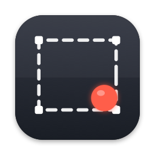
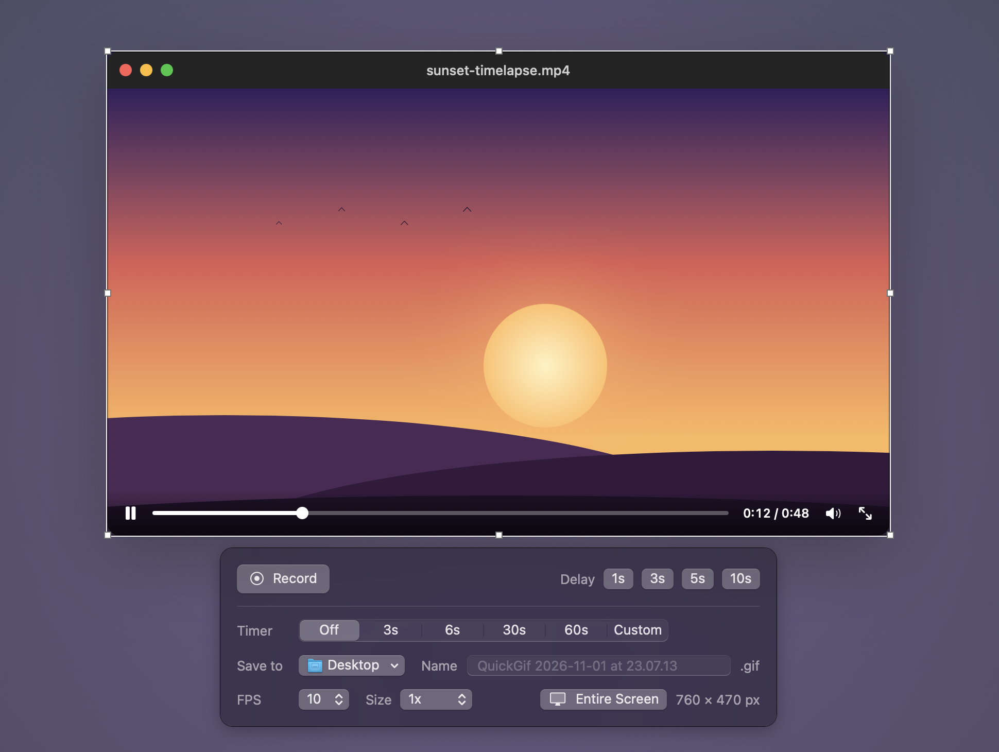
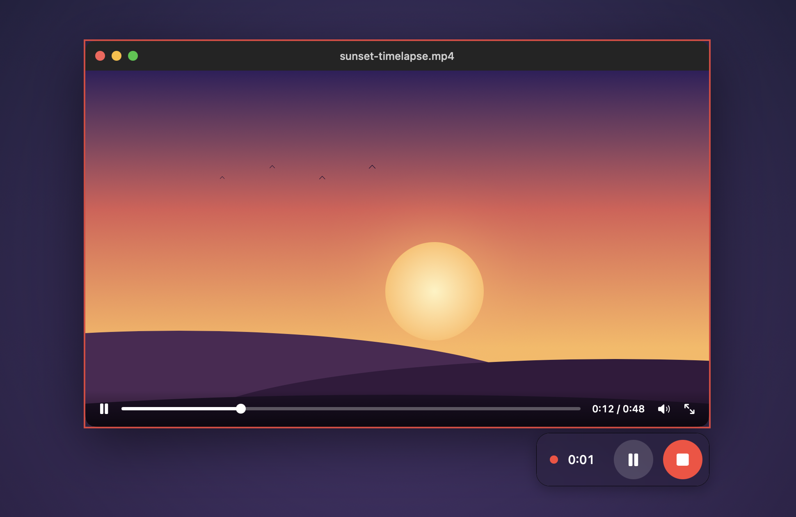
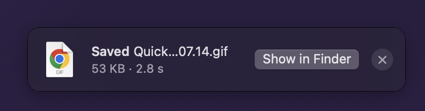

<p align="center">
  
</p>
<h1 align="center">QuickGif</h1>
<p align="center">Click button, draw area, record GIF.</p>

<p align="center">
  
</p>

## About

Sometimes I need to grab a GIF off a YouTube video or something similar. There's a decades-old app called LICEcap that does this, but I was tired of using it. Click button, draw area, record GIF.

## Quickstart for your agent

Paste this into Claude Code, or any agent with a shell:

> Install QuickGif on this Mac: clone https://github.com/0xc00010ff/QuickGif, build it with the xcodebuild command in the README's Manual quickstart, copy QuickGif.app to /Applications, and open it. Tell me when macOS asks for Screen Recording permission so I can grant it.

## Manual quickstart

Needs macOS 14 and Xcode 16 or later. No dependencies.

```bash
git clone https://github.com/0xc00010ff/QuickGif.git && cd QuickGif
xcodebuild -project QuickGif.xcodeproj -scheme QuickGif -configuration Release -derivedDataPath build/DerivedData CODE_SIGN_STYLE=Manual CODE_SIGN_IDENTITY=- DEVELOPMENT_TEAM= -quiet
cp -R build/DerivedData/Build/Products/Release/QuickGif.app /Applications/
open /Applications/QuickGif.app
```

Grant **Screen Recording** when macOS asks, then open QuickGif again. The command above produces an ad-hoc signed app; to build in Xcode instead, pick your own team under Signing & Capabilities.

## Using it

1. **Click the dock icon.** The screen dims, ⌘⇧4 style.
2. **Draw a box**, or click **Select Entire Screen** (⌘A). Handles resize it, dragging moves it, Delete clears it.
3. **Record**: click anywhere, press Return, or hit the Record button. Or pick a **1 / 3 / 5 / 10 s** delay and set the scene; Esc during the countdown goes back.
4. **Options** live in the panel under the box. Drag it aside if it's in the way.
   - **Timer** stops automatically at 3, 6, 30 or 60 s, or a custom number of seconds.
   - **Save to** and **Name**, **FPS** (5 to 30) and **Size** (1x or Retina).
5. **While recording** the box is a thin red frame with Pause and Stop at its corner. Pausing adds Restart, which throws the take away and starts over. QuickGif never records its own windows.
6. **Stop** writes the GIF and shows a toast: click it to open the file, or Show in Finder, or × to dismiss.

<p align="center">
  
  &nbsp;&nbsp;
  
</p>

Esc cancels before recording starts. ⌘N starts a new selection, ⌘. stops a recording, and the dock menu has both. Quitting mid-recording saves first.

## How it works

| Piece | File(s) | Notes |
|---|---|---|
| Session flow | `App/SessionController.swift` | `idle → selecting → countdown → recording → saving` |
| Region picker | `UI/SelectionOverlayWindow.swift`, `UI/SelectionView.swift`, `UI/SelectionHintView.swift` | One borderless window per display at screen-saver level; the hint offers Select Entire Screen |
| Options panel | `UI/OptionsPanel.swift` | SwiftUI, bound to `Preferences.shared` (UserDefaults) |
| Recording controls | `UI/RecordingControlsPanel.swift`, `UI/RecordingBorderWindow.swift` | Non-activating panel, so Pause/Stop never steal focus |
| Capture | `Capture/ScreenRecorder.swift` | ScreenCaptureKit, region via `sourceRect`, QuickGif's own app excluded from the filter |
| Encoding | `Encoding/GIFEncoder.swift` | Streaming GIF89a writer: frame differencing, transparent unchanged pixels, exact palettes for UI content, median cut otherwise |

Frames stream from ScreenCaptureKit straight into the encoder, so memory stays flat for long recordings. A frame is shown until the next one arrives and identical frames are coalesced, so an idle screen costs almost nothing.

## License

MIT. See [LICENSE](LICENSE).

---

<p align="center"><i>Clarity in brevity is the ultimate sophistication</i></p>
